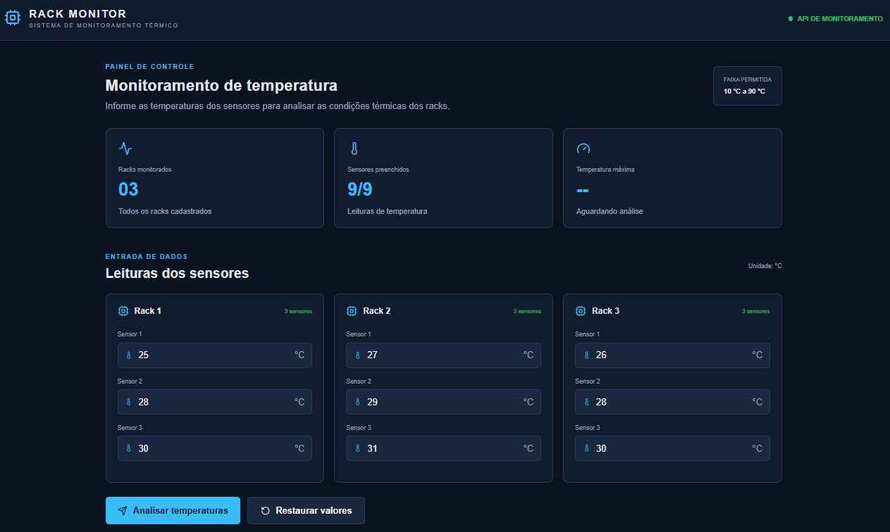
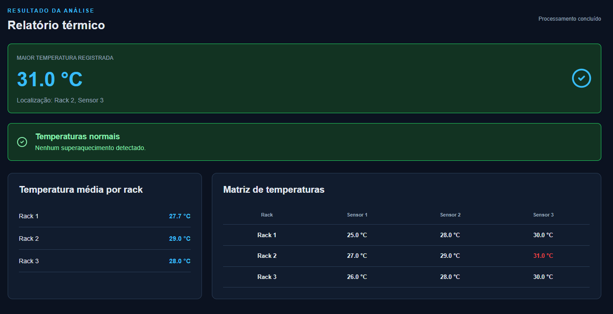
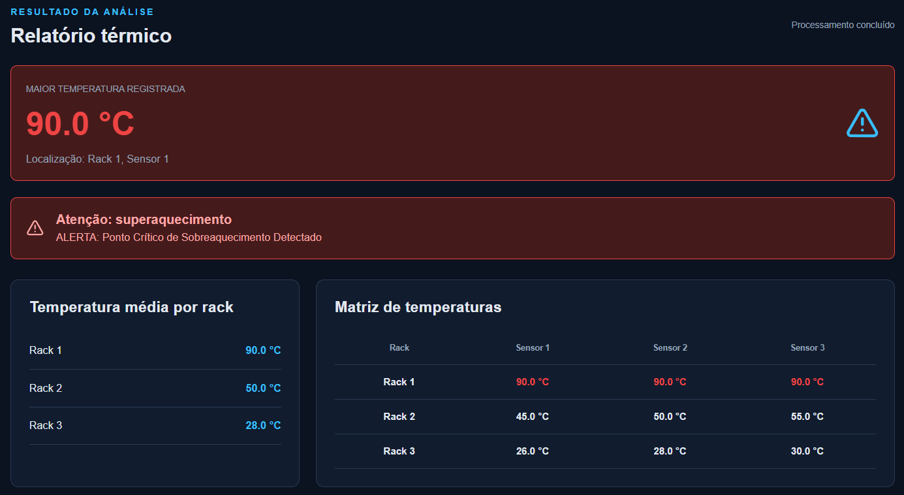

# Rack Monitor — Monitoramento Térmico de Data Centers

[](https://github.com/lucasmportela/Rack-Monitor-Monitoramento-Termico-de-Data-Centers/actions/workflows/ci.yml)
[](https://rack-monitor-demo.onrender.com)


Aplicação web para simular o monitoramento térmico de **3 racks de servidores, com 3 sensores por rack**. O usuário informa as temperaturas, e o sistema calcula as médias, identifica o sensor com a maior leitura e sinaliza possíveis situações de superaquecimento.

## Demonstração online

<https://rack-monitor-demo.onrender.com>

A demonstração está hospedada no **Render (plano gratuito)** e utiliza **PostgreSQL gerenciado pelo Neon** para armazenar o histórico. A conexão é configurada pela variável de ambiente `DATABASE_URL`; nenhuma credencial do banco é armazenada no repositório. Como o serviço pode entrar em suspensão após um período sem acessos, a primeira abertura depois da inatividade pode levar um pouco mais de tempo.

> **Importante:** este projeto é uma demonstração educacional. As temperaturas são informadas manualmente e não há conexão com sensores físicos. Não utilize dados de infraestrutura real.

## Funcionalidades

- Monitoramento simulado de 9 sensores distribuídos em 3 racks.
- Entrada e validação de temperaturas entre **10 °C e 90 °C**.
- Cálculo da temperatura média de cada rack.
- Identificação da maior temperatura e da localização do sensor (rack e sensor).
- Alerta de superaquecimento quando uma leitura é **igual ou superior a 75 °C**.
- Painel com os sensores, relatório térmico e histórico das análises recentes.
- Consulta das últimas 20 análises, com opção de reabrir relatórios anteriores.
- API REST para validar, processar e registrar a matriz de temperaturas.
- Proteção básica da API com limite de requisições, limite de corpo JSON e cabeçalhos HTTP de segurança.
- Execução local com Vite ou em containers com Docker Compose.

## Demonstração visual

### Tela inicial

Painel para visualizar os três racks e informar as temperaturas dos nove sensores.



### Relatório térmico

Apresenta a matriz enviada, as médias por rack, a maior temperatura identificada e o status do monitoramento.



### Alerta de superaquecimento

O alerta é exibido quando pelo menos um sensor registra temperatura igual ou superior a 75 °C.



## Tecnologias

| Camada | Tecnologias |
|---|---|
| Frontend | React 19, Vite, JavaScript, CSS e Lucide React |
| Backend | Node.js, Express e CORS |
| Testes | Node.js Test Runner, Vitest, React Testing Library e user-event |
| Persistência | PostgreSQL gerenciado pelo Neon na demonstração pública; JSON local no desenvolvimento |\n| Infraestrutura | Docker, Docker Compose, Nginx, GitHub Actions e Render |

## Arquitetura

- **Desenvolvimento local:** o Vite serve a interface React e encaminha as chamadas `/api` para o servidor Express.
- **Docker Compose:** frontend e backend executam em containers separados. O Nginx serve a interface e encaminha as chamadas da API.
- **Render:** uma imagem Docker de produção compila o frontend e o copia para o backend. O Express entrega os arquivos React e atende a API na mesma origem.
- **Histórico:** PostgreSQL quando `DATABASE_URL` está configurada; arquivo JSON local para desenvolvimento sem banco externo.

## Histórico de análises

Cada envio válido é registrado com data e hora, matriz de temperaturas, médias por rack, maior leitura, localização do sensor e status de alerta. A interface apresenta os 20 registros mais recentes e permite reabrir um relatório.

- **Demonstração pública:** o serviço Render utiliza PostgreSQL gerenciado pelo Neon, conectado por `DATABASE_URL`. As medições são gravadas na tabela `rack_monitor_history`, e o histórico permanece disponível após reinicializações e novos deploys do serviço. A resposta de `/api/historico` informa `tipo: "PostgreSQL"` e `persistente: true` quando esse armazenamento está ativo.

### Validação após reinicialização

Em **12 de novembro de 2026**, a demonstração foi submetida a um teste prático de persistência:

1. Duas medições já estavam registradas no histórico do PostgreSQL do Neon.
2. O serviço da aplicação foi reiniciado manualmente no Render.
3. Após o serviço voltar ao estado ativo, a rota `GET /api/historico` continuou apresentando as duas medições anteriores.
4. Uma consulta SQL diretamente ao banco confirmou que os registros permaneciam armazenados.

**Resultado:** o histórico foi preservado após a reinicialização da aplicação. Esse teste valida a persistência entre reinicializações do serviço; não representa, por si só, um teste separado de restauração ou recuperação de desastre do banco.
- **Desenvolvimento local:** sem `DATABASE_URL`, os registros são gravados em `backend/data/history.json`, arquivo ignorado pelo Git.
- **Limite:** a aplicação conserva os 100 registros mais recentes por padrão. Ajuste com `HISTORY_MAX_RECORDS` (de 1 a 500).
- **Atenção ao Render Free:** sem banco externo, o sistema de arquivos do serviço é temporário e o histórico pode ser perdido em reinicializações, suspensão ou novo deploy. A API informa quando esse modo temporário está ativo.

Para usar PostgreSQL localmente, defina `DATABASE_URL` antes de iniciar o backend. A tabela `rack_monitor_history` é criada automaticamente na primeira consulta ou gravação.

## Regras de negócio

1. A entrada deve conter exatamente 3 racks.
2. Cada rack deve conter exatamente 3 sensores.
3. Cada temperatura deve ser um número entre 10 °C e 90 °C.
4. Leituras iguais ou superiores a 75 °C ativam o alerta.
5. A média é calculada individualmente para cada rack.
6. O relatório identifica a maior leitura e informa rack e sensor com numeração iniciada em 1 na interface.

## Executar localmente

### Pré-requisitos

- Node.js 20 ou superior.
- npm.
- Git.

### 1. Clonar o repositório

```bash
git clone https://github.com/lucasmportela/Rack-Monitor-Monitoramento-Termico-de-Data-Centers.git
cd Rack-Monitor-Monitoramento-Termico-de-Data-Centers
```

### 2. Iniciar o backend

Abra um terminal na raiz do projeto.

**Windows PowerShell:**

```powershell
cd backend
npm.cmd install
npm.cmd run dev
```

**Git Bash, Linux ou macOS:**

```bash
cd backend
npm install
npm run dev
```

A API ficará disponível em `http://localhost:3001`. Para verificar se está ativa, acesse:

<http://localhost:3001/api/health>

### 3. Iniciar o frontend

Abra outro terminal na raiz do projeto.

**Windows PowerShell:**

```powershell
cd frontend
npm.cmd install
npm.cmd run dev
```

**Git Bash, Linux ou macOS:**

```bash
cd frontend
npm install
npm run dev
```

Acesse <http://localhost:5173>.

Durante o desenvolvimento, o Vite encaminha as requisições iniciadas por `/api` para `http://localhost:3001`.

## Executar com Docker Compose

Com Docker e Docker Compose instalados, execute na raiz do projeto:

```bash
docker compose up --build
```

Acesse <http://localhost:8080>.

O Nginx serve o frontend e encaminha as chamadas `/api` para o backend pela rede interna do Docker.

Para encerrar os containers:

```bash
docker compose down
```

## API REST

### `GET /api/health`

Verifica a disponibilidade da aplicação e é utilizado pelo health check da hospedagem.

Resposta:

```json
{
  "status": "ok"
}
```

### `POST /api/monitoramento`

Recebe uma matriz com 3 racks e 3 temperaturas em cada rack, calcula o relatório e registra a análise no histórico.

### `GET /api/historico?limit=20`

Retorna os registros mais recentes (limite entre 1 e 100), incluindo data/hora, matriz, médias, maior temperatura, localização e alerta. A resposta também informa o tipo de armazenamento e se ele é persistente no ambiente atual.

Exemplo de requisição:

```json
{
  "matriz": [
    [25.5, 30.0, 35.2],
    [40.0, 45.5, 50.0],
    [60.0, 70.0, 78.5]
  ]
}
```

A resposta inclui:

- Matriz validada.
- Média de temperatura de cada rack.
- Maior temperatura identificada.
- Localização do sensor mais quente.
- Indicador e mensagem de alerta.

Para testar localmente com cURL:

```bash
curl -X POST http://localhost:3001/api/monitoramento \
  -H "Content-Type: application/json" \
  -d '{"matriz":[[25,30,35],[40,45,50],[60,70,78.5]]}'
```

**Windows PowerShell:**

```powershell
$body = '{"matriz":[[25,30,35],[40,45,50],[60,70,78.5]]}'
Invoke-RestMethod -Uri "http://localhost:3001/api/monitoramento" -Method Post -ContentType "application/json" -Body $body
```

## Segurança e configuração

A API inclui algumas proteções básicas:

- CORS restrito às origens configuradas.
- Corpo JSON limitado a 10 KB.
- Limite padrão de 60 requisições por IP a cada 60 segundos na rota de monitoramento.
- Cabeçalhos HTTP como `X-Content-Type-Options`, `X-Frame-Options` e `Referrer-Policy`.
- Cabeçalho `X-Powered-By` desabilitado.
- Respostas das rotas da API com `Cache-Control: no-store`.

As principais configurações podem ser definidas por variáveis de ambiente:

```env
CORS_ORIGINS=http://localhost:5173,http://127.0.0.1:5173
RATE_LIMIT_MAX=60
RATE_LIMIT_WINDOW_MS=60000
TRUST_PROXY=1
```

Para múltiplas origens, separe os endereços por vírgula. Em produção, a interface e a API são servidas pela mesma origem, portanto as chamadas feitas pelo frontend não precisam de uma origem CORS adicional.

**Limitações:** o contador de requisições é mantido em memória e reinicia quando o processo é reiniciado. Essa proteção é básica e não substitui autenticação, firewall de aplicação ou monitoramento de produção.

## Testes automatizados

O projeto possui **32 cenários automatizados**:

- **26 testes de integração do backend:** rotas de status, health check e histórico, processamento da matriz, cálculo de médias, validações, persistência e consulta dos registros, CORS, cabeçalhos de segurança, limite do corpo JSON e rate limiting.
- **6 testes do frontend:** renderização dos sensores, validação, restauração, envio e exibição do relatório, tratamento de falha de conexão e reabertura de registros do histórico.

### Testar o backend

Na pasta `backend`:

```bash
npm install
npm test
```

### Testar o frontend

Na pasta `frontend`:

```bash
npm install
npm test
```

### Build de produção do frontend

Na pasta `frontend`:

```bash
npm run build
```

O GitHub Actions executa os testes do backend, os testes do frontend e o build React em pushes e pull requests direcionados à branch `main`. Após as verificações, também constrói a imagem Docker utilizada na demonstração.

Acompanhe as execuções em [GitHub Actions](https://github.com/lucasmportela/Rack-Monitor-Monitoramento-Termico-de-Data-Centers/actions).

## Estrutura do projeto

```text
Rack-Monitor-Monitoramento-Termico-de-Data-Centers/
├── backend/
│   ├── Dockerfile
│   ├── package.json
│   ├── server.js
│   ├── history-store.js
│   └── tests/
│       └── monitoramento.test.js
├── frontend/
│   ├── Dockerfile
│   ├── index.html
│   ├── nginx.conf
│   ├── package.json
│   ├── vite.config.js
│   └── src/
│       ├── App.jsx
│       ├── App.test.jsx
│       ├── main.jsx
│       ├── style.css
│       └── test/
│           └── setup.js
├── docs/
│   └── screenshots/
├── .github/
│   └── workflows/
│       └── ci.yml
├── .dockerignore
├── .gitignore
├── Dockerfile
├── docker-compose.yml
├── render.yaml
└── README.md
```

## Melhorias futuras

- Integração com sensores físicos ou fontes reais de telemetria.
- Atualização automática das leituras.
- Gráficos históricos e notificações de incidentes.
- Autenticação e gerenciamento de usuários.

## Autor

Projeto desenvolvido para praticar desenvolvimento web, integração entre frontend e backend, criação de APIs REST, testes automatizados e conteinerização.

**Demonstração:** <https://rack-monitor-demo.onrender.com>  
**Repositório:** <https://github.com/lucasmportela/Rack-Monitor-Monitoramento-Termico-de-Data-Centers>
